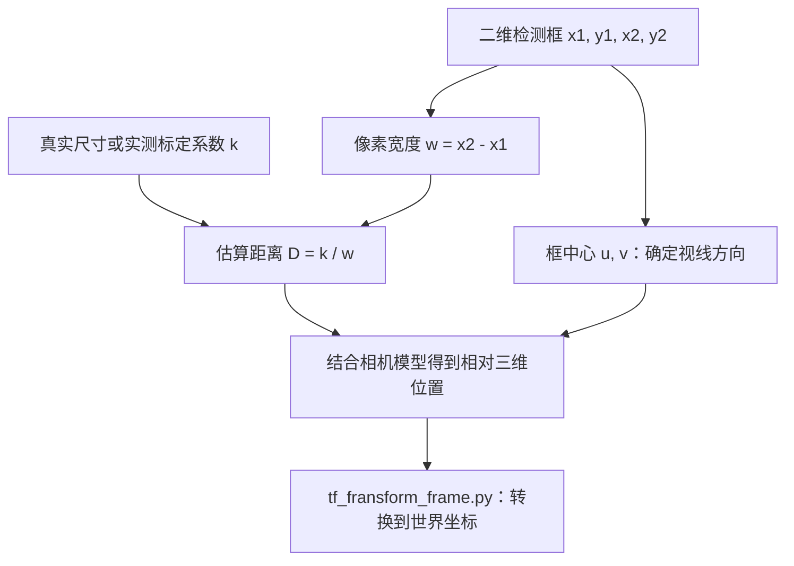

# 从二维检测框估算目标距离：单目测距与三维坐标转换

**本文重点：如何根据二维检测框的像素宽度或高度，计算相机到目标的距离估计。** 核心是同一个目标“近大远小”的透视关系，以及如何标定比例系数。

已核对配套检测代码 `v888_drone_frame.py`：当前实现使用检测框宽度 `x2 - x1`，计算 `distance = (4000 / 2.86) / (x2 - x1)`。[tf_fransform_frame.py](reference/tf_fransform_frame.py) 则接收上游已经算好的相对三维坐标，完成后续世界坐标转换；它本身不执行二维测距。

## 核心：二维检测框怎样算出距离？

### 1. 从检测框中取像素尺寸

YOLO 输出目标框的左上角 `(x1, y1)` 和右下角 `(x2, y2)`：

```python
w_pixel = x2 - x1       # 检测框的像素宽度。
h_pixel = y2 - y1       # 检测框的像素高度。
center_x = (x1 + x2) / 2
center_y = (y1 + y2) / 2
```

**框尺寸用于估算远近；框中心用于估算视线方向。** 两者作用不同，当前测距函数没有使用 `center_x`、`center_y`。

| 符号 | 含义 | 单位 |
| --- | --- | --- |
| `w_pixel` | 检测框宽度 `x2 - x1` | 像素 |
| `h_pixel` | 检测框高度 `y2 - y1`；若简称 `h`，这里指图像中的像素高度 | 像素 |
| `W_real / H_real` | 目标的真实宽度 / 真实高度 | 米 |
| `fx / fy` | 相机横向 / 纵向焦距 | 像素 |
| `D` | 尺寸模型估计的距离，理想正对相机条件下对应光轴深度 | 米 |
| `k` | 已标定的“距离 × 像素尺寸”系数 | 米·像素 |

### 2. 为什么能用“系数 ÷ 像素尺寸”？

在针孔相机模型中，若目标近似正对相机、用于测量的宽度两端具有相同光轴深度：

$$
\frac{w_{pixel}}{f_x} = \frac{W_{real}}{D}
$$

移项得到：

$$
\boxed{D = \frac{f_x W_{real}}{w_{pixel}} = \frac{k_w}{w_{pixel}}}
$$

对于同一种固定尺寸的目标、同一套相机成像配置，`fx × W_real` 可以合并成常数 `k_w`。因此检测框宽度减半，估计距离就变成两倍。

如果使用检测框高度 `h_pixel`，同样的推导是：

$$
\boxed{D = \frac{f_y H_{real}}{h_{pixel}} = \frac{k_h}{h_{pixel}}}
$$

这里 `k_h = fy × H_real`。**使用宽度还是高度，要与真实尺寸和标定系数对应。** 不能把宽度标定的系数直接用于高度，除非已经验证两者系数一致。

仅有二维像素位置无法唯一确定距离。这种单目测距方法之所以可用，是因为额外引入了“目标真实尺寸固定”或“已通过实测标定系数”的约束。

### 3. 配套代码实际怎样计算？

`v888_drone_frame.py` 中的原始测距函数为：

```python
def distance_ws(length):
    k = 4000 / 2.86
    distance = k / length
    return distance
```

在检测结果循环中，它这样调用：

```python
distance = distance_ws(x2 - x1)
```

逐步代入：

```text
YOLO 输出检测框 (x1, y1, x2, y2)
    ↓
取框宽 w_pixel = x2 - x1
    ↓
计算固定系数 k = 4000 / 2.86 ≈ 1398.6014
    ↓
计算距离 distance = k / w_pixel
```

因此，当前源码真正执行的公式是：

$$
\boxed{distance = \frac{4000}{2.86\,(x_2-x_1)}}
$$

**当前使用的是宽度，`y2 - y1` 没有参与测距。** 后续代码在此距离基础上结合目标角度估计 `box_x / box_y / box_z`，再传给坐标转换节点。

源码没有说明 `4000` 与 `2.86` 各自来自哪次实验或哪项物理量，不能仅凭数字认定它们是焦距、真实尺寸或已知距离。能确定的是：它们的比值被当作固定测距系数；其单位和适用范围需要通过原始标定记录或实测确认。下游按米使用该结果，因此相应系数应按“米·像素”标定。

### 4. 用一组二维框算一遍

设目标框为 `(100, 200, 300, 400)`，则宽度 `w_pixel = 300 - 100 = 200 px`。按原函数：

$$
distance = \frac{4000/2.86}{200} \approx 6.993\ \text{m}
$$

| 框宽 w_pixel | 按源码系数得到的距离 | 变化规律 |
| --- | --- | --- |
| `100 px` | `13.986 m` | 宽度为 200 px 时的一半，距离为两倍 |
| `200 px` | `6.993 m` | 本例 |
| `400 px` | `3.497 m` | 宽度为 200 px 时的两倍，距离为一半 |

以下例子可以独立运行。它保留原公式，并增加对无效框宽的检查：

```python
import math


def estimate_distance(box, k=4000 / 2.86):
    x1, y1, x2, y2 = box
    width_pixel = x2 - x1
    if not math.isfinite(width_pixel) or width_pixel <= 0:
        raise ValueError("检测框宽度必须为正且有限")
    if not math.isfinite(k) or k <= 0:
        raise ValueError("测距系数必须为正且有限")
    return k / width_pixel


for width in (100, 200, 400):
    box = (100.0, 200.0, 100.0 + width, 400.0)
    print(f"框宽 {width} px -> 距离 {estimate_distance(box):.3f} m")
```

预期输出：

```text
框宽 100 px -> 距离 13.986 m
框宽 200 px -> 距离 6.993 m
框宽 400 px -> 距离 3.497 m
```

以上是对原公式的复现，不表示该系数已经适配你的相机和目标。例子中的输入检查也没有修改原始检测函数。

### 5. k 应该怎样标定？

最直接的办法是用已知距离与对应的框尺寸求乘积：

$$
k_w = D_{ref}\,w_{ref},\qquad
k_h = D_{ref}\,h_{ref}
$$

例如，在与实际运行相同的相机分辨率和检测坐标尺度下，测得某固定目标距离为 `5.0 m`，框宽为 `280 px`：

```text
k_w = 5.0 × 280 = 1400 m·px
新一帧框宽为 200 px 时，D = 1400 / 200 = 7.0 m
```

这组数字是演示标定过程的新例子，不是源码常数 `4000 / 2.86` 的来源。标定时应先定义测量的是光轴深度还是相机到目标的斜距；若沿光轴正前方标定，两者在该位置一致。

实际操作建议：

1. 固定目标的真实尺寸、相机分辨率、镜头焦距及检测坐标尺度，使目标近似正对相机。
2. 在多个已知距离采样，记录每组 `D_ref` 和 `w_ref`，得到多个 `k_i = D_ref × w_ref`。
3. 可取这些 `k_i` 的中位数作为初值，再用未参与标定的距离验证误差；若系数随距离或姿态明显变化，需检查模型假设。
4. 不同类别若真实宽度不同，应分别标定系数。共享同一个 `k` 不能自动消除目标尺寸差异。

### 6. 哪些因素会让距离算错？

| 因素 | 对结果的影响 |
| --- | --- |
| 同类别目标真实大小不同 | 同样的框宽可能对应不同距离，固定系数无法区分 |
| 目标倾斜或部分遮挡 | 框宽与完整目标真实宽度不再对应，常会使距离估计偏大 |
| 框坐标被缩放 | 若宽度变成原来的 `s` 倍，系数也需变成 `s × k`，或先还原框坐标 |
| 检测框抖动 | `D = k / w`，小框对像素误差更敏感；例如 20 px 的框误差 2 px，可能带来约 10% 的距离误差 |
| 框宽为 0 或负值 | 原函数没有检查，会出现除零或无意义结果；需在上游过滤 |
| 镜头畸变或变焦 | 尺寸投影与标定条件发生变化，需去畸变或重新标定 |

配套代码先将检测框转成整数，再使用 `x2 - x1`，很小的框还可能受到取整误差影响。源码用同一系数选择 `distance` 最小的目标，实际等价于选框最宽的目标；只有目标真实宽度可比时，这才近似代表最近的目标。

### 7. 测得距离以后，才进入三维计算



在理想尺寸模型中，估计的 `D` 对应光轴深度 `Zc`。已知中心 `(u, v)` 后，可计算 `Xc = (u-cx) × D / fx`、`Yc = (v-cy) × D / fy`、`Zc = D`。

配套检测代码会把 `distance` 送入三角函数计算相对坐标，相当于将其当成视线方向的距离使用；不能仅因变量名叫 `distance` 就认定它与光轴深度或直线距离完全一致。若按宽度模型得到的是光轴深度，离轴目标需先按下文相机模型计算坐标，不能直接拿该深度当斜距。其目标角度与相机外参也需分别核对。

## 继续阅读与仓库内容

- [三维坐标转换与 ROS TF 演示](docs/coordinate-transforms.md)：相机模型、机体与世界坐标转换、原脚本的输入输出和已验证的 ROS 示例。
- [原始参考脚本 tf_fransform_frame.py](reference/tf_fransform_frame.py)：保留原实现，便于对照世界坐标计算。

```text
pixel-to-world-3d/
├── README.md                         # 二维框测距公式、系数标定与误差
├── docs/
│   └── coordinate-transforms.md       # 三维坐标转换与 ROS 演示
└── reference/
    └── tf_fransform_frame.py          # 原始世界坐标转换脚本
```

相机投影公式可参考 [ROS CameraInfo 消息定义](https://docs.ros.org/en/noetic/api/sensor_msgs/html/msg/CameraInfo.html)。本文区分配套源码的实际算法和用于解释原理的标定示例，未将示例系数当作设备实测结果。
