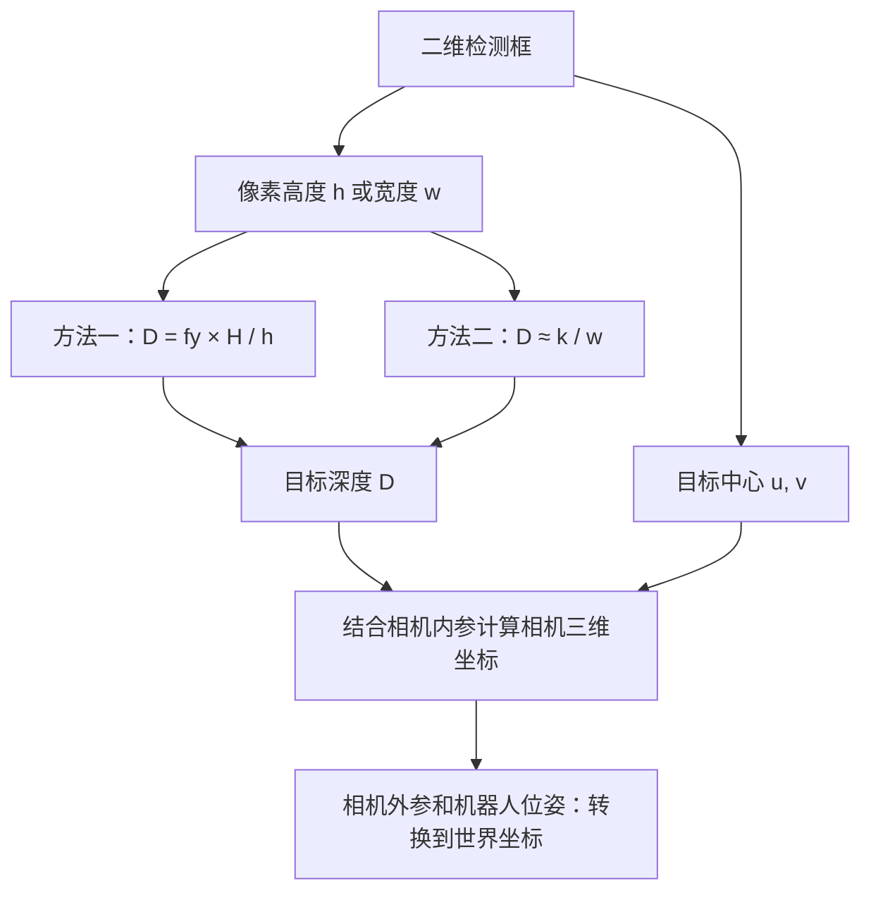

# 二维检测框测距：相机模型法与实测反比法

通过 YOLO 检测框估算距离，可以使用下面两种方法。它们都利用固定尺寸目标“近大远小”的关系，区别在于**比例系数怎样得到**。

| 方法 | 距离公式 | 系数来源 |
| --- | --- | --- |
| 方法一：相机模型 + 真实高度 | `D = fy × H / h` | 相机标定得到 `fy`，测量目标真实高度 `H` |
| 方法二：真实距离 + 像素框宽标定 | `D ≈ k / w` | 用已知距离和对应框宽标定 `k ≈ D_ref × w_ref` |

配套检测代码 `v888_drone_frame.py` 使用第二种形式，实际计算为 `distance = (4000 / 2.86) / (x2 - x1)`。[tf_fransform_frame.py](reference/tf_fransform_frame.py) 则接收上游已经计算好的相对三维坐标，将其转换到世界坐标；该脚本本身没有进行二维框测距。

本文先分别说明两种方法，再比较精度、标定条件与误差。后续三维转换和 ROS 使用方法见 [三维坐标转换与 ROS TF](docs/coordinate-transforms.md)。

- [检测框、符号与距离定义](#definitions)
- [方法一：用焦距和目标真实高度计算距离](#camera-model)
- [方法二：用实测距离标定框宽反比关系](#empirical-calibration)
- [两种方法的关系与精度比较](#comparison)
- [共同误差与验证方法](#validation)
- [从距离到三维坐标](#coordinates)

<a id="definitions"></a>

## 1. 检测框、符号与距离定义

YOLO 输出目标框左上角 `(x1, y1)` 和右下角 `(x2, y2)`，从中可以计算：

```python
w = x2 - x1                 # 检测框宽度，像素。
h = y2 - y1                 # 检测框高度，像素。
u = (x1 + x2) / 2           # 框中心横坐标。
v = (y1 + y2) / 2           # 框中心纵坐标。
```

**框尺寸用于估算远近，框中心结合相机内参确定视线方向。** 仅知道中心像素位置，无法唯一确定距离；这里额外利用了目标真实尺寸固定的条件。

| 符号 | 含义 | 单位 |
| --- | --- | --- |
| `w / h` | 检测框的像素宽度 / 像素高度 | 像素 |
| `W / H` | 目标真实宽度 / 真实高度 | 米 |
| `fx / fy` | 相机横向 / 纵向焦距 | 像素 |
| `cx / cy` | 相机主点坐标 | 像素 |
| `D` | 目标光轴深度，即相机坐标中的 `Zc` | 米 |
| `r` | 相机光心到目标中心的直线距离 | 米 |
| `k` | 实测得到的距离与像素尺寸乘积系数 | 米·像素 |

本文的 `h` 始终表示**检测框在图像中的像素高度**，`H` 表示目标本身的真实高度，例如门框顶部到底部的长度。

相机模型公式求出的是光轴深度 `D`，目标位于光轴上时它等于直线距离 `r`。实测标定也要先明确测量的是哪一种距离；后文统一按深度 `D` 讲解。若沿光轴正前方标定，两者在标定位置一致，但不能因此认定离轴时仍然相等。

<a id="camera-model"></a>

## 2. 方法一：用焦距和目标真实高度计算距离

### 2.1 思路：用已知尺寸作为尺子

设一个门框真实高度固定为 `H`。在相同成像条件下，门框越远，图像中占据的高度 `h` 越小。相机焦距 `fy` 决定真实尺寸投影到图像后的比例。

在针孔相机模型下，假设目标近似正对相机、上下端处于相同光轴深度，测量的高度方向与相机竖直轴对齐，则相似三角形关系为：

$$
\frac{h}{f_y}=\frac{H}{D}
$$

移项得到：

$$
\boxed{D=\frac{f_y H}{h}}
$$

其含义是：目标真实高度与焦距不变时，像素高度减半，估算距离就翻倍。

### 2.2 从投影公式推导

相机光学坐标系的 Y 轴向下。设目标顶部、底部的相机坐标为 `Y_top`、`Y_bottom`，两者深度均为 `D`：

$$
v_{top}=f_y\frac{Y_{top}}{D}+c_y,\qquad
v_{bottom}=f_y\frac{Y_{bottom}}{D}+c_y
$$

相减后，主点坐标 `cy` 消掉：

$$
h=v_{bottom}-v_{top}
+=f_y\frac{Y_{bottom}-Y_{top}}{D}
+=f_y\frac{H}{D}
$$

因此，满足上述条件时，单独计算深度只需要 `fy`、`H`、`h`，不需要先计算目标中心。若目标倾斜或检测框范围与真实高度不对应，最后一步就不再严格成立。

### 2.3 三个输入怎样取得？

1. **测量真实高度 `H`。** 如果检测框包围整个门框，使用门框外部高度；若检测的是门洞，使用门洞高度。真实尺寸要和检测范围对应，不同尺寸目标不能共用同一个 `H`。
2. **标定相机得到 `fy`。** 相机内参矩阵中的第二行第二列就是纵向焦距，以像素为单位。镜头标注的毫米焦距不能直接代入。
3. **计算像素高度 `h = y2 - y1`。** 使用去畸变后、与内参尺度匹配的坐标。目标顶部和底部需要完整可见。

相机内参矩阵为：

$$
K=\begin{bmatrix}
f_x & 0 & c_x\\
0 & f_y & c_y\\
0 & 0 & 1
\end{bmatrix}
$$

对于经过校正的图像，应使用对应投影参数，例如 ROS `CameraInfo.P` 中的纵向焦距。图像经过缩放、裁剪或 letterbox 时，要还原检测坐标或使用同步调整后的参数。

### 2.4 数值例子与可运行代码

假设 `fy = 600 px`、目标真实高度 `H = 1.0 m`，检测框顶部 `y1 = 180`、底部 `y2 = 380`：

$$
h=380-180=200\ \text{px},\qquad
D=\frac{600\times1.0}{200}=3.0\ \text{m}
$$

| 像素高度 h | 估算深度 D |
| --- | --- |
| `400 px` | `1.5 m` |
| `200 px` | `3.0 m` |
| `100 px` | `6.0 m` |

以下例子只依赖 Python 标准库：

```python
import math


def depth_from_height(y1, y2, fy, real_height_m):
    h = y2 - y1
    values = (h, fy, real_height_m)
    if not all(math.isfinite(value) and value > 0 for value in values):
        raise ValueError("像素高度、焦距和真实高度必须是正的有限数")
    return fy * real_height_m / h


depth = depth_from_height(180.0, 380.0, fy=600.0, real_height_m=1.0)
print(f"方法一：光轴深度 {depth:.3f} m")
```

预期输出：

```text
方法一：光轴深度 3.000 m
```

这是演示参数，不代表已经测量或标定了当前设备。

<a id="empirical-calibration"></a>

## 3. 方法二：用实测距离标定框宽反比关系

### 3.1 思路：直接测出距离和框宽的比例关系

这就是“真实距离与像素框宽大致成反比”的方法。对同一个固定尺寸目标，在相机配置和目标朝向近似不变时：

$$
D\approx\frac{k}{w}
$$

将目标放在已知距离 `D_ref`，记录对应框宽 `w_ref`，即可得到：

$$
\boxed{k\approx D_{ref}w_{ref}},\qquad
\boxed{D\approx\frac{k}{w}}
$$

这种方法**不必分别知道焦距和目标真实宽度**，而是通过实际检测结果直接标定二者形成的比例系数。目标真实尺寸仍需要保持一致；更换尺寸后，原系数通常不能继续沿用。

### 3.2 单点与多点标定

例如，在已知距离 `5.0 m` 处测得框宽 `280 px`：

```text
k = 5.0 × 280 = 1400 m·px
之后测到框宽 200 px：D = 1400 / 200 = 7.0 m
```

可在多个距离记录 `k_i = D_i × w_i`，用中位数作为系数初值，再用独立数据验证。下面三组是便于复算的理想演示数据，并非设备实测记录：

| 已知深度 D_ref | 检测框宽 w_ref | 乘积 k_i |
| --- | --- | --- |
| `2.0 m` | `700 px` | `1400 m·px` |
| `4.0 m` | `350 px` | `1400 m·px` |
| `5.0 m` | `280 px` | `1400 m·px` |

如果实际采样中 `k_i` 随距离或目标姿态明显变化，说明固定反比系数对这些条件不够适用，需要检查框的定义、目标姿态、畸变及距离测量方法。

以下例子包含标定和测距两个步骤，只依赖 Python 标准库：

```python
import math
from statistics import median


def calibrate_width_coefficient(samples):
    # 每组数据为：已知深度（米），该深度处的框宽（像素）。
    if not samples:
        raise ValueError("至少需要一组标定数据")
    products = []
    for depth_m, width_px in samples:
        if not all(math.isfinite(value) and value > 0
                   for value in (depth_m, width_px)):
            raise ValueError("标定深度和框宽必须是正的有限数")
        products.append(depth_m * width_px)
    return median(products)


def depth_from_width(x1, x2, k):
    w = x2 - x1
    if not all(math.isfinite(value) and value > 0 for value in (w, k)):
        raise ValueError("检测框宽度和测距系数必须是正的有限数")
    return k / w


k = calibrate_width_coefficient([(2.0, 700.0), (4.0, 350.0), (5.0, 280.0)])
depth = depth_from_width(100.0, 300.0, k)
print(f"方法二：标定系数 {k:.3f} m·px，估算深度 {depth:.3f} m")
```

预期输出：

```text
方法二：标定系数 1400.000 m·px，估算深度 7.000 m
```

### 3.3 当前配套代码的实际公式

已核对的配套检测代码 `v888_drone_frame.py` 中，测距函数是：

```python
def distance_ws(length):
    k = 4000 / 2.86
    distance = k / length
    return distance
```

调用时传入检测框宽度：

```python
distance = distance_ws(x2 - x1)
```

因此当前代码使用固定系数 `k ≈ 1398.6014`，实际执行：

$$
distance=\frac{4000}{2.86\,(x_2-x_1)}
$$

| 检测框宽 w | 按源码系数得到的 distance |
| --- | --- |
| `100 px` | `13.986 m` |
| `200 px` | `6.993 m` |
| `400 px` | `3.497 m` |

当前用的是宽度 `x2 - x1`，高度 `y2 - y1` 没有参与测距。这里按实测反比系数说明该方法；源码没有记录常数 `4000` 和 `2.86` 各自的标定来源，不能从代码倒推出某次实验数据。上述 `k = 1400` 是独立教学例子，不是这两个常数的来源。

配套代码先将框坐标转成整数，也没有在原始 `distance_ws()` 中检查零框宽。上面的教学函数增加了输入检查，未修改原检测器或参考脚本。

<a id="comparison"></a>

## 4. 两种方法的关系与精度比较

### 4.1 相同的反比关系，不同的系数来源

在理想相机模型下：

$$
D=\frac{f_yH}{h}=\frac{k_h}{h},\qquad k_h=f_yH
$$

宽度方向同样满足：

$$
D=\frac{f_xW}{w}=\frac{k_w}{w},\qquad k_w=f_xW
$$

因此需要分开考虑两项选择：

- **系数来源：** 可以根据相机内参与真实尺寸计算，也可以根据已知距离实测标定。
- **测量方向：** 两种来源都可以使用框高或框宽；宽度系数和高度系数要分别确定。

不能把框宽标定得到的 `k_w` 直接用于框高 `h`。方法一、方法二示例中的目标尺寸与参数也不同，输出 `3 m` 和 `7 m` 不构成精度对比。

### 4.2 哪种更适合当前设备？

**两种方法都没有天然更高的精度，需比较同一套独立验证数据上的误差。**

| 比较项 | 方法一：相机模型 + 框高 | 方法二：实测标定 + 框宽 |
| --- | --- | --- |
| 准备数据 | `fy`、真实高度 `H`、像素高度 `h` | 已知距离与对应框宽，得到 `k` |
| 优势 | 参数物理意义清楚，真实尺寸变化时可显式更新 | 直接按当前相机和检测器标定，可能更贴合实际框尺寸 |
| 主要误差来源 | 内参、真实高度、框高及几何假设误差 | 标定距离、框宽、样本分布及几何假设误差 |
| 目标变化 | 需要提供正确的新高度 | 不同真实尺寸通常要重新标定或按类别配置 |
| 相机或尺度变化 | 更新对应内参及坐标 | 调整或重新标定系数及坐标 |

若门框保持竖直、相机水平、主要只有左右侧视，框高可能比框宽更稳定；但这是特定几何条件下的选择，明显俯仰、滚转、遮挡和检测框变化仍会影响结果。实际应选择像素尺寸较大、检测更稳定且几何关系更一致的方向。

实测反比法可能在标定覆盖的条件下比直接套用不准确内参和尺寸更准；准确标定的相机模型也可能表现更好。实际误差决定结论。

<a id="validation"></a>

## 5. 共同误差与验证方法

### 5.1 先保持测量条件一致

| 检查项 | 对两种方法的影响 |
| --- | --- |
| 目标真实尺寸 | 同类别不一定同尺寸，同样像素框可能对应不同距离 |
| 目标姿态 | 倾斜后投影尺寸变化；水平检测框宽高还会受滚转影响 |
| 完整可见性 | 遮挡、出画和框偏小会造成尺寸与真实值不匹配 |
| 检测坐标尺度 | 必须与内参或实测标定所用尺度一致 |
| 镜头和畸变 | 变焦、分辨率变化或明显畸变需要相应调整或重新标定 |
| 框的有效性 | 过滤零、负、NaN、Inf 尺寸；保留浮点框可避免过早取整 |
| 距离的定义 | 光轴深度与直线距离要区分，不能混用标定与评估数据 |

若图像纵向缩小到原来的 `s` 倍，则方法一中的 `fy` 与 `h` 都应变成原来的 `s` 倍。方法二中若横向框宽变成原来的 `s` 倍，系数也应变为 `s × k`。也可以统一把框坐标还原到原图后再计算。

两种方法都符合 `D = k / size`。一阶误差近似为：

$$
\frac{\delta D}{D}\approx\frac{\delta k}{k}
-\frac{\delta size}{size}
$$

在系数准确、仅有尺寸测量误差时，框尺寸 `200 px` 抖动 `2 px` 约对应 `1%` 距离误差；`20 px` 抖动 `2 px` 约对应 `10%`。这是小误差近似，不包含姿态、遮挡或标定误差，也不是测距精度保证。

### 5.2 用独立数据比较精度

1. 固定相机配置和目标，统一距离定义；为方法一准备内参及真实高度，为方法二采集标定数据。
2. 另外采集验证数据，覆盖近、中、远距离和实际会出现的侧视角度，记录每帧真实距离、框宽和框高。
3. 在相同验证帧上分别计算 `D1 = fy × H / h` 与 `D2 = k / w`。
4. 比较平均绝对误差、平均相对误差、最大误差及连续帧抖动；按距离、角度分组查看，避免总体平均值掩盖某段明显失准。

$$
MAE=\frac{1}{N}\sum_{i=1}^{N}|D_{pred,i}-D_{true,i}|
$$

$$
MAPE=\frac{100\%}{N}\sum_{i=1}^{N}
\frac{|D_{pred,i}-D_{true,i}|}{D_{true,i}}
$$

方法二拟合系数的数据不应同时作为精度结论的唯一依据。本文尚未提供设备实测验证集，因此不宣称某一种方法已经更准。

<a id="coordinates"></a>

## 6. 从距离到三维坐标

距离还需要结合目标中心像素，才能确定三维位置。接入 ROS 时，建议依次完成下面四步，避免把不同参考系下的数值直接相加。



### 6.1 结合中心像素得到相机坐标

当估计结果为光轴深度 `D` 时，结合检测中心 `(u, v)` 和相机内参：

$$
X_c=\frac{u-c_x}{f_x}D,\qquad
Y_c=\frac{v-c_y}{f_y}D,\qquad Z_c=D
$$

相机光心到该中心点的直线距离为：

$$
r=D\sqrt{1+\left(\frac{u-c_x}{f_x}\right)^2
+\left(\frac{v-c_y}{f_y}\right)^2}
$$

如果输入的本来就是直线距离 `r`，应先把视线方向归一化再乘 `r`，不能直接令 `Zc=r`。具体换算见 [深度与直线距离的两种反投影](docs/coordinate-transforms.md#pixel-to-camera)。

### 6.2 按相机外参转换为机体坐标

相机光学轴为 X 向右、Y 向下、Z 向前，ROS 常用机体轴为 X 向前、Y 向左、Z 向上。相机水平朝前、没有安装倾角时，先映射为 `(Zc, -Xc, -Yc)`，再加光心在机体坐标中的安装平移；有安装倾角则使用实际外参：

$$
\mathbf{p}_b=R_{bc}\mathbf{p}_c+\mathbf{t}_{bc}
$$

### 6.3 按机器人位姿转换为世界坐标

使用机器人姿态旋转机体相对位置，再加世界位置：

$$
\mathbf{p}_w=R_{wb}\mathbf{p}_b+\mathbf{t}_{wb}
$$

完整姿态应来自四元数。只使用 yaw 是水平运动的简化，机器人明显俯仰或滚转时会产生误差。相机外参和机器人位姿均已存在于 TF 树时，可以让 TF 按检测时刻组合变换。

### 6.4 封装 ROS 消息并核对结果

检测位置使用 `PointStamped`，需要姿态或控制目标时使用 `PoseStamped`。`header.frame_id` 填坐标当前实际所在的参考帧，时间戳对应图像采集时刻；只改 frame 名称不会改变坐标数值。

详细教程用同一个目标逐步复算：像素中心 `(440,300)`、深度 `2 m`，相机在机体前方 `0.10 m`、上方 `0.04 m`，机器人位于 `(1,2,1.5)` 且 yaw 为 `90°`：

| 阶段 | 坐标 | 参考系 |
| --- | --- | --- |
| 相机反投影 | `(0.4, 0.2, 2.0)` | `camera_optical_frame` |
| 加相机安装旋转和平移 | `(2.1, -0.4, -0.16)` | `base_link` |
| 加机器人旋转和平移 | `(1.4, 4.1, 1.34)` | `world` |

这些是教学参数，完整的相机内参、计算过程和代码见 [从测距开始的完整算例](docs/coordinate-transforms.md#worked-example)。

配套检测代码将 `distance` 送入三角函数计算相对坐标，按视线距离使用。若按尺寸模型得到的实际是光轴深度，离轴目标需先按上述模型求坐标，不能未经转换就把深度当斜距。`tf_fransform_frame.py` 接收到 `box_x / box_y / box_z` 后不会重新计算或校正这个距离。

完整推导、四元数、原脚本高度符号见 [三维坐标转换教程](docs/coordinate-transforms.md)；可以直接运行的坐标转换节点、TF 树配置和话题发布命令见 [ROS 消息与 TF 演示](docs/coordinate-transforms.md#ros-publishing)。

## 7. 仓库内容与参考资料

```text
pixel-to-world-3d/
├── README.md                         # 两种二维测距方法、标定与精度比较
├── docs/
│   └── coordinate-transforms.md       # 三维坐标转换与 ROS 演示
└── reference/
    └── tf_fransform_frame.py          # 原始世界坐标转换脚本
```

- [ROS CameraInfo：内参、光学坐标及校正投影](https://docs.ros.org/en/noetic/api/sensor_msgs/html/msg/CameraInfo.html)
- [ROS REP-103：单位与坐标轴约定](https://www.ros.org/reps/rep-0103.html)
- [原始参考脚本](reference/tf_fransform_frame.py)

文中的数值、标定样本和教学代码用于解释与复算；当前设备精度需要另外采集真实验证数据评估。
