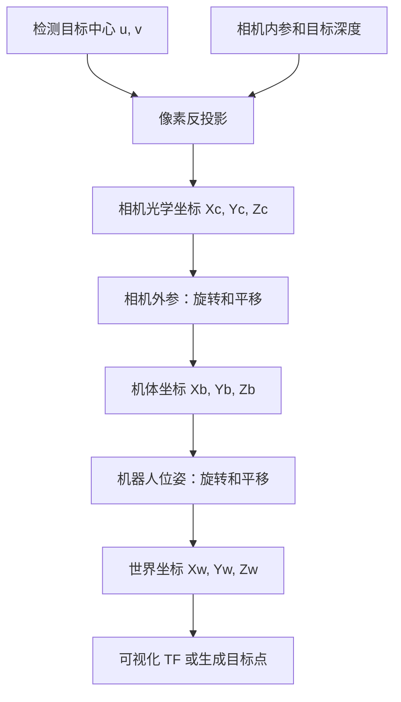

# 二维像素坐标转三维世界坐标：从相机模型到 ROS TF

以 [tf_fransform_frame.py](reference/tf_fransform_frame.py) 为参考，说明如何把图像中的目标中心 `(u, v)`，结合深度、相机标定和机器人位姿，转换成三维世界坐标，并在 ROS 中广播 TF、发布目标点。

**二维像素本身不能唯一确定三维位置，还需要深度或其他几何约束。** 参考脚本实现的是流程后半段：接收上游已经计算好的 `box_x / box_y / box_z`，结合里程计得到世界坐标。它虽然读取 `center_x / center_y`，但没有使用像素坐标进行反投影。

本文给出完整的几何推导、可直接运行的 Python 例子，以及原脚本的 ROS1 演示。参考脚本按原样保留，文中明确区分数学模型、演示假设与原代码行为。

## 1. 完整流程



参考脚本不包含相机驱动、目标检测、深度估计或相机外参标定；这些数据需要由上游提供。

## 2. 第一步：像素坐标 → 相机三维坐标

### 2.1 相机内参和深度

针孔相机内参为：

$$
K = \begin{bmatrix}
f_x & 0 & c_x \\
0 & f_y & c_y \\
0 & 0 & 1
\end{bmatrix}
$$

| 符号 | 含义 | 单位 |
| --- | --- | --- |
| `u, v` | 目标中心在当前图像中的横、纵坐标 | 像素 |
| `fx, fy` | 横、纵方向焦距 | 像素 |
| `cx, cy` | 主点坐标 | 像素 |
| `Zc` | 目标沿相机光轴的深度 | 米 |

在已经去畸变、内参与当前图像分辨率匹配的前提下：

$$
X_c = \frac{u-c_x}{f_x}Z_c,\qquad
Y_c = \frac{v-c_y}{f_y}Z_c,\qquad
Z_c = D(u,v)
$$

ROS 相机光学坐标系通常为 **X 向右、Y 向下、Z 向前**。目标中心在主点右侧时 `Xc > 0`，位于主点下方时 `Yc > 0`。

实际接入需要注意：

- 深度图必须与检测图像对齐，取同一像素对应的深度；毫米值先乘 `0.001` 转成米。
- 使用与图像处理流程对应的内参。原始图像需要结合畸变参数；校正图像通常使用 `CameraInfo.P` 对应的内参。裁剪、缩放、letterbox 后，需要把检测点还原到标定图像，或同步更新内参。
- 目标框中心可能落在背景或无效深度上；应检查深度是否为正且有限，可在目标有效区域内取中值。

### 2.2 光轴深度与直线距离的区别

上面的 `Zc` 是沿光轴的深度，不是相机到目标的欧氏距离。如果传感器给出沿该像素视线的直线距离 `r`，先令：

$$
a = \frac{u-c_x}{f_x},\qquad b = \frac{v-c_y}{f_y}
$$

再计算：

$$
\mathbf{p}_c = \frac{r}{\sqrt{a^2+b^2+1}}
\begin{bmatrix}a\\b\\1\end{bmatrix}
$$

单目 YOLO 只给出检测框和类别，不直接提供米制深度。若目标真实宽度 `W` 已知、目标平面近似正对相机，可用 `Zc ≈ fx × W / w_pixel` 估计光轴深度；物体倾斜、遮挡、检测框误差都会影响精度。原脚本中的 `distance` 只被读取和打印，没有参与坐标计算，因此该字段本身不能补齐像素到三维的过程。

## 3. 第二步：相机坐标 → 机体坐标

ROS 常用机体坐标约定为 **X 向前、Y 向左、Z 向上**，与相机光学坐标不同。

通用转换公式是：

$$
\mathbf{p}_b = R_{bc}\mathbf{p}_c + \mathbf{t}_{bc}
$$

其中 `Rbc` 将相机坐标表示的向量旋转到机体坐标，`tbc` 是相机光心在机体坐标系中的位置。

只有在**相机朝前、没有安装倾角、光心与机体原点重合**时，才可使用下面的简化映射：

$$
X_b=Z_c,\qquad Y_b=-X_c,\qquad Z_b=-Y_c
$$

真实相机通常存在安装平移和俯仰角，需要使用标定外参，不能只交换轴或添加一个经验高度。参考脚本没有执行这一步，必须在构造 `box_x / box_y / box_z` 前完成。

## 4. 第三步：机体坐标 → 世界坐标

一般情况下，应使用机器人完整姿态：

$$
\mathbf{p}_w = R_{wb}\mathbf{p}_b + \mathbf{t}_{wb}
$$

组合相机外参后：

$$
\mathbf{p}_w = R_{wb}(R_{bc}\mathbf{p}_c+\mathbf{t}_{bc})+\mathbf{t}_{wb}
$$

参考脚本只使用里程计四元数中的偏航角 `yaw`，忽略 roll 和 pitch。因此其简化模型适用于姿态近似水平、输入轴向已经统一的情况。

### 4.1 原脚本的实际公式

`calculate_target_world_position()` 执行：

```python
world_x = drone_world_x + box_x * math.cos(yaw) - box_y * math.sin(yaw)
world_y = drone_world_y + box_x * math.sin(yaw) + box_y * math.cos(yaw)
world_z = drone_world_z - box_z
```

这里 `yaw` 的单位为弧度，来自里程计姿态；消息中的 `yaw_angle`、`pitch_angle` 没有参与该计算。

**必须先确认 `box_z` 的正方向。** 原脚本使用减法：`box_z > 0` 会使目标世界高度降低。若上游输出的是标准机体坐标 `Zb`（向上为正），应在输入接口转换成 `box_z = -Zb`，或者在后续修改版本中统一改成标准机体坐标并使用完整旋转矩阵。不能把向上为正的 `Zb` 原样送入当前脚本。

为了与本文的标准机体坐标一致，后面的演示显式使用：

```text
box_x = Xb
box_y = Yb
box_z = -Zb
```

这是演示的输入适配约定，并不表示原脚本已经校验了上游轴向。也不要把这个混合符号的三元组直接当作标准右手 TF 坐标系。

### 4.2 世界原点和固定偏移

里程计的 `pose` 应按消息的 `header.frame_id` 解释。原脚本直接复制位置和姿态，却把输出坐标系硬编码为 `world`；它没有执行 `odom → world` 的转换。因此只有上游里程计与该 `world` 代表同一个原点和轴向时，输出才成立。“起飞原点”是脚本的使用假设，代码没有自动记录或重置起飞原点。

原始目标和最终目标还存在区别：

```python
final_x = world_x + 0.1
final_y = world_y
final_z = world_z + 1.3
```

`0.1 m` 和 `1.3 m` 是原脚本的固定目标偏移，作用在**世界坐标轴**上，不会随机器人偏航旋转，也不是相机安装外参。

## 5. 可运行的完整数值例子

下面只依赖 Python 标准库。假设相机已去畸变、朝前且光心与机体原点重合，机器人保持水平：

```python
import math

# 目标像素、相机内参、沿光轴深度，数值仅用于演示。
u, v = 440.0, 300.0
fx, fy, cx, cy = 600.0, 600.0, 320.0, 240.0
depth_m = 2.0
if not math.isfinite(depth_m) or depth_m <= 0:
    raise ValueError("深度必须是正的有限数，单位为米")

# 像素 -> 相机光学坐标。
xc = (u - cx) * depth_m / fx
yc = (v - cy) * depth_m / fy
zc = depth_m

# 相机光学坐标 -> 标准机体坐标，仅适用本例安装假设。
xb, yb, zb = zc, -xc, -yc

# 适配原脚本：box_z 向下为正。
box_x, box_y, box_z = xb, yb, -zb

# 机器人世界位置和偏航角。
drone_x, drone_y, drone_z = 1.0, 2.0, 1.5
yaw = math.radians(90.0)
world_x = drone_x + box_x * math.cos(yaw) - box_y * math.sin(yaw)
world_y = drone_y + box_x * math.sin(yaw) + box_y * math.cos(yaw)
world_z = drone_z - box_z
goal = (world_x + 0.1, world_y, world_z + 1.3)

print("相机坐标:", tuple(round(x, 3) for x in (xc, yc, zc)))
print("机体坐标:", tuple(round(x, 3) for x in (xb, yb, zb)))
print("世界坐标:", tuple(round(x, 3) for x in (world_x, world_y, world_z)))
print("最终目标:", tuple(round(x, 3) for x in goal))
```

预期输出：

```text
相机坐标: (0.4, 0.2, 2.0)
机体坐标: (2.0, -0.4, -0.2)
世界坐标: (1.4, 4.0, 1.3)
最终目标: (1.5, 4.0, 2.6)
```

## 6. 原脚本的 ROS 接口

面向 **ROS1 Noetic / Python3**，依赖 `rospy`、`tf`、`geometry_msgs`、`nav_msgs`、`std_msgs` 和 `numpy`。ROS2 需要移植节点及 TF 接口后才能运行。

| 方向 | 话题 | 消息类型 | 用途 |
| --- | --- | --- | --- |
| 订阅 | `/yolov8_set_param` | `std_msgs/String` | 目标相对三维坐标及检测信息 |
| 订阅 | `/mavros/local_position/odom` | `nav_msgs/Odometry` | 机器人位置和姿态 |
| 发布 | `/move_base_simple/goal` | `geometry_msgs/PoseStamped` | 带固定偏移的目标，`frame_id=world` |
| 广播 | `/tf` | TF 变换 | `world` 下的目标与机器人坐标系 |

`String.data` 的格式是逗号分隔的 `key:value`，不是 JSON：

```text
center_x:440,center_y:300,frame_name:gate,distance:2.04939,yaw_angle:11.30993,pitch_angle:-5.71059,box_x:2.0,box_y:-0.4,box_z:0.2
```

其中 `distance` 和角度字段仅作为检测元数据存储、打印。本例的角度分别表示像素相对光轴的水平/垂直角，不是机体的姿态。真正参与目标位置计算的是 `box_x / box_y / box_z` 与里程计。

| TF 子坐标系 | 含义 |
| --- | --- |
| `target_original` | 原始目标的世界坐标，单位四元数 |
| `target_final` | 叠加固定偏移后的世界坐标，单位四元数 |
| `drone_current` | 机器人位置和仅包含 yaw 的姿态 |
| `target_<序号>_<frame_name>` | 按类别名称存储的历史目标位置 |

目标 TF 的姿态是单位四元数，而发布的 `PoseStamped` 朝向跟随机器人当前 yaw，两者的方向信息不同。相同 `frame_name` 会覆盖旧位置，不是逐帧累积独立目标。

## 7. 在独立 ROS Master 中演示

以下命令使用独立端口，并将目标输出重映射到 `/tutorial/goal`，适合先验证数值和 RViz 可视化。它们不会启动 MAVROS、检测器或导航控制器。

先下载仓库并进入项目根目录。在下面每个新终端中，先执行：

```bash
source /opt/ros/noetic/setup.bash
export ROS_MASTER_URI=http://127.0.0.1:11321
export ROS_IP=127.0.0.1
```

**终端 A：启动 Master。**

```bash
roscore -p 11321
```

**终端 B：在项目根目录启动原脚本。**

```bash
/usr/bin/python3 reference/tf_fransform_frame.py \
  /move_base_simple/goal:=/tutorial/goal
```

**终端 C：持续提供演示里程计。** 世界位置为 `(1, 2, 1.5)`，四元数对应 yaw 为 90°；四元数顺序为 `x, y, z, w`。

```bash
rostopic pub -r 10 /mavros/local_position/odom nav_msgs/Odometry \
  '{header: {frame_id: world}, child_frame_id: base_link, pose: {pose: {position: {x: 1.0, y: 2.0, z: 1.5}, orientation: {x: 0.0, y: 0.0, z: 0.7071067811865476, w: 0.7071067811865476}}}}'
```

**终端 D：先监听目标输出。**

```bash
rostopic echo -n 1 /tutorial/goal
```

**终端 E：确认节点已收到里程计后，发送检测结果。**

```bash
rostopic pub -1 /yolov8_set_param std_msgs/String \
  '{data: "center_x:440,center_y:300,frame_name:gate,distance:2.04939,yaw_angle:11.30993,pitch_angle:-5.71059,box_x:2.0,box_y:-0.4,box_z:0.2"}'
```

目标输出应为 `frame_id: world`，位置约 `(1.5, 4.0, 2.6)`，姿态约 `(0, 0, 0.707107, 0.707107)`。启动后首次发布可能等待至多约 8 秒，这是原脚本的发布节流逻辑。

可在另一个已配置环境的终端查看：

```bash
rosrun tf tf_echo world target_original
rosrun tf tf_echo world target_final
```

分别应得到约 `(1.4, 4.0, 1.3)` 和 `(1.5, 4.0, 2.6)`。RViz 的 Fixed Frame 设为 `world`，添加 TF 显示即可观察；演示结束后用 `Ctrl+C` 停止各终端。

话题名称中的 `move_base` 不代表已经具备无人机三维导航能力。原脚本只发布一个 `PoseStamped`；具体控制器是否支持 Z 轴、是否消费该话题，取决于下游实现。

## 8. 接入真实数据时的边界

| 检查项 | 原脚本行为及影响 |
| --- | --- |
| 高度符号 | `world_z = drone_z - box_z`，上游若采用向上为正，需要先适配 |
| 完整姿态 | 只使用 yaw；明显倾斜时，使用完整四元数对应的旋转矩阵 |
| 相机外参 | 未计算，需由上游补齐安装旋转和平移 |
| 参考坐标系 | 未读取、校验或变换里程计的 `header.frame_id`，输出固定标记为 `world` |
| 时间同步 | 使用最新保存的里程计，检测字符串没有时间戳；运动时可能错配 |
| 尚未收到里程计 | 直接返回相对坐标作为世界坐标，而非拒绝该目标；`has_odom` 也不会检查位姿是否过期 |
| 字段校验 | 缺少数值字段时默认填 0，没有拒绝 NaN、Inf 或不合理深度 |
| 目标偏移 | 固定叠加世界 X 方向 `0.1 m`、Z 方向 `1.3 m`，不是通用参数 |
| 发布间隔 | 目标发布由回调和一次性定时器节流，间隔意图为 8 秒；TF 主循环约 10 Hz |
| 定时器与并发 | 延迟发布时读取当前共享目标；多次检测可能覆盖待发布目标，线程间没有加锁，严格频率和一致快照需要另行处理 |
| 初始 TF | 启动后即广播零值目标及带偏移目标，并不表示已完成有效检测 |
| 目标身份 | 字典按 `frame_name` 覆盖，不能区分同类别的多个实例；名称也未进行 TF 标识符清理 |

以上是参考代码的实际边界，本仓库保留原实现，未将这些行为描述为已经修复。更通用的实现应统一使用右手坐标系，携带时间戳和 frame ID，并通过 TF 查询检测时刻的完整外参及位姿。

## 9. 仓库内容与参考资料

```text
pixel-to-world-3d/
├── README.md                         # 原理、公式、数值例子和 ROS 演示
└── reference/
    └── tf_fransform_frame.py          # 原始参考脚本，保留原文件名与实现
```

原脚本 SHA-256：`0215c7652c5e730670e2f4d5256eb7d20c7293250547c87e2d1be9ffab6f558f`。

- [ROS REP-103：单位与坐标轴约定](https://www.ros.org/reps/rep-0103.html)
- [sensor_msgs/CameraInfo：光学坐标、内参、畸变及校正投影](https://docs.ros.org/en/noetic/api/sensor_msgs/html/msg/CameraInfo.html)
- [nav_msgs/Odometry：pose 与 twist 的参考坐标系](https://docs.ros.org/en/noetic/api/nav_msgs/html/msg/Odometry.html)
- [geometry_msgs/PoseStamped：带时间戳和参考坐标系的位姿](https://docs.ros.org/en/noetic/api/geometry_msgs/html/msg/PoseStamped.html)
- [ROS tf：坐标变换库](https://wiki.ros.org/tf)
