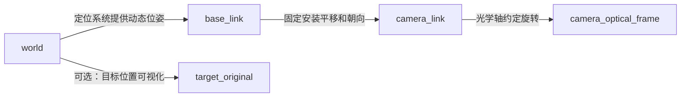

# 根据测得距离计算 ROS 三维坐标：从像素到相机、机体和世界坐标

[首页](../README.md) 介绍用框高相机模型法、框宽实测反比法获得距离。本篇接着说明：**怎样把距离和目标像素位置变成 ROS 中带参考坐标系的三维位置，并发布消息与 TF。**

核心计算链为：

```text
测距结果 + 目标中心像素 + 相机内参
    → 相机光学坐标 p_c
    → 相机安装旋转和平移 → 机体坐标 p_b
    → 机器人姿态和位置 → 世界坐标 p_w
    → 带 frame_id 和时间戳的 ROS 消息
```

参考脚本 [tf_fransform_frame.py](../reference/tf_fransform_frame.py) 实现的是后半段的简化版本：接收上游已经计算好的 `box_x / box_y / box_z`，用机器人 yaw 和位置转换世界坐标。本文先讲完整方法，再对照原脚本及其输入约定。

- [准备数据与认识坐标系](#inputs-and-frames)
- [像素与距离 → 相机坐标](#pixel-to-camera)
- [相机坐标 → 机体坐标](#camera-to-body)
- [机体坐标 → 世界坐标](#body-to-world)
- [对照原脚本的计算](#reference-conventions)
- [从二维测距开始的完整数值例子](#worked-example)
- [ROS 消息与 TF 的实际发布](#ros-publishing)

<a id="inputs-and-frames"></a>

## 1. 准备数据与认识坐标系

### 1.1 只有距离还不能确定目标在哪里

同样是距离 2 米，目标可能在左侧、右侧、上方或下方。检测框中心 `(u, v)` 决定视线方向，距离决定沿该方向的位置尺度；相机内参把像素偏移转换成几何方向。

需要的输入如下：

| 输入 | 从哪里获得 | 用途 |
| --- | --- | --- |
| 中心像素 `u, v` | 检测框中心，`u=(x1+x2)/2`、`v=(y1+y2)/2` | 确定目标视线 |
| 深度 `D` 或直线距离 `r` | 首页两种测距方法或距离传感器 | 确定尺度，并明确是哪种距离 |
| `fx, fy, cx, cy` | 相机标定或对应 `CameraInfo` | 把像素换成相机空间坐标 |
| 相机外参 `Rbc, tbc` | 相机与机体的安装标定、已有 TF | 确定相机相对机体的位置和朝向 |
| 机器人位姿 `Rwb, twb` | 里程计、定位系统或已有 TF | 确定机体相对世界的位置和朝向 |
| 图像时间戳、frame ID | 图像与关联的相机消息 | 使用检测时刻的正确变换 |

### 1.2 ROS 坐标需要同时说明参考系

`(2, 0, 0)` 这样的三元组不具有唯一含义：在相机光学坐标中表示光心右侧 2 米，在机体坐标中表示机体前方 2 米。ROS 用 `header.frame_id` 表明这些数值在哪个坐标系下表达。

| 坐标系 | 本文名称示例 | X / Y / Z 方向 |
| --- | --- | --- |
| 图像坐标 | 像素 `u, v` | u 向右，v 向下，单位像素 |
| 相机光学坐标 | `camera_optical_frame` | X 向右、Y 向下、Z 向前，单位米 |
| 机体坐标 | `base_link` | X 向前、Y 向左、Z 向上，单位米 |
| 世界或定位坐标 | `world`，实际项目也可能是 `map`、`odom` | 由定位系统定义，本文取 Z 向上 |

`map`、`odom` 和 `world` 可能有不同原点或轴向，不可仅改名字就视为同一个坐标系。MAVROS 输入也应核对话题实际采用的 ROS 坐标约定，不要在已经转换后的数据上重复做 NED/ENU 轴变换。

本文记 `Rbc` 为把相机向量转换成机体表达的旋转，`tbc` 为相机光心在机体坐标中的位置；`Rwb, twb` 同理。所有位置以米为单位，数学运算的角度以弧度为单位，ROS 四元数字段顺序为 `(x, y, z, w)`。

<a id="pixel-to-camera"></a>

## 2. 第一步：像素与距离 → 相机坐标

### 2.1 先计算归一化视线

设检测框中心为 `(u, v)`：

$$
a=\frac{u-c_x}{f_x},\qquad b=\frac{v-c_y}{f_y}
$$

对应的视线方向为 `(a, b, 1)`。它还没有长度单位，也不是单位向量。不能直接把像素值当成米制坐标。

例如 `u=440`、`v=300`，内参 `fx=fy=600`、`cx=320`、`cy=240`，则：

```text
a = (440 - 320) / 600 = 0.2
b = (300 - 240) / 600 = 0.1
视线方向 = (0.2, 0.1, 1)
```

目标在主点右侧、下方，因此光学坐标的 X、Y 分量均为正。

### 2.2 如果测到的是光轴深度 D

首页的理想目标尺寸模型得到的是光轴深度 `D=Zc`。在已经去畸变、内参与当前图像尺度匹配的前提下：

$$
\boxed{\mathbf{p}_c=\begin{bmatrix}X_c\\Y_c\\Z_c\end{bmatrix}
=D\begin{bmatrix}a\\b\\1\end{bmatrix}}
$$

即：

```python
xc = (u - cx) * depth_m / fx
yc = (v - cy) * depth_m / fy
zc = depth_m
```

本例 `D=2 m`，所以相机光学坐标为 `(0.4, 0.2, 2.0) m`：目标在光心右侧 0.4 米、下方 0.2 米、前方 2 米。

若距离来自深度图，需要先对齐到检测图像；毫米读数先乘 `0.001`。若来自检测框测距，直接使用与内参匹配的检测框中心，注意模型输入缩放与 letterbox 的坐标还原。校正图像应使用对应投影内参，例如 `CameraInfo.P`；不要混用原始畸变图像的内参和经过其他处理的像素点。

### 2.3 如果测到的是直线距离 r

直线距离是相机光心到目标的向量长度，不能直接令 `Zc=r`。应先把视线归一化：

$$
s=\sqrt{a^2+b^2+1},\qquad
\boxed{\mathbf{p}_c=\frac{r}{s}\begin{bmatrix}a\\b\\1\end{bmatrix}}
$$

相应地，`D=r/s`，而 `r=D×s`。在本例中：

```text
s = sqrt(0.2² + 0.1² + 1) ≈ 1.024695
D = 2.0 m 对应 r ≈ 2.049390 m
```

将 `r=2.049390... m` 代入归一化公式，也会得到 `(0.4, 0.2, 2.0) m`。如果输入的是 `r=2.0 m`，则对应 `(0.390360, 0.195180, 1.951800) m`，这是另一个位置。

| 测距结果 | 如何得到相机坐标 |
| --- | --- |
| 已知光轴深度 `D` | `(a×D, b×D, D)` |
| 已知相机光心到目标的直线距离 `r` | `(a, b, 1) / sqrt(a²+b²+1) × r` |

实测反比标定如果使用斜距作为标签，只能在标定条件适用范围内作为该斜距的估计；固定框宽系数不能自动补偿任意离轴角度。接入前要统一距离定义。

### 2.4 要不要先计算 yaw 和 pitch？

直接使用归一化视线即可得到坐标，不必先换成角度再换回来。如果上游接口需要角度，在相机水平朝前的假设下可定义：

$$
\alpha=\operatorname{atan2}(a,1),\qquad
\beta=\operatorname{atan2}(-b,\sqrt{1+a^2})
$$

其中 `α` 是向右为正的水平视线偏角，`β` 是向上为正的真实仰角。已知直线距离 `r` 时，相对于相机光心、以机体轴向表达的坐标为：

$$
x=r\cos\beta\cos\alpha,\qquad
y=-r\cos\beta\sin\alpha,\qquad
z=r\sin\beta
$$

这里的 `β` 与像素角 `-atan(b)` 在横向偏移不为零时不同，目标视线角也不同于机器人的姿态角。配套检测代码直接组合 `atan(a)`、`-atan(b)` 和 `distance`，因此接入时应核对距离与角度的定义；下面统一用向量方法说明。

<a id="camera-to-body"></a>

## 3. 第二步：相机坐标 → 机体坐标

### 3.1 为什么需要变换坐标轴？

相机的“前方”是 Z 轴，机体的“前方”是 X 轴。因此不能把 `(Xc, Yc, Zc)` 原样发布为 `base_link` 下的位置。

相机**水平朝前、无安装倾角**时，光学坐标到机体方向的旋转为：

$$
R_{bc}=\begin{bmatrix}
0 & 0 & 1\\
-1 & 0 & 0\\
0 & -1 & 0
\end{bmatrix}
$$

这个旋转把光学 Z 向前映射到机体 X 向前，把光学 X 向右映射到机体负 Y，把光学 Y 向下映射到机体负 Z。

### 3.2 再加相机安装平移

设相机光心在机体前方 0.10 米、左侧 0 米、上方 0.04 米，则 `tbc=(0.10, 0, 0.04)`：

$$
\boxed{\mathbf{p}_b=R_{bc}\mathbf{p}_c+\mathbf{t}_{bc}}
$$

展开为：

```python
xb = zc + 0.10
yb = -xc
zb = -yc + 0.04
```

本例相机坐标为 `(0.4, 0.2, 2.0)`，得到机体坐标 `(2.1, -0.4, -0.16) m`，表示目标在机体前方 2.1 米、右侧 0.4 米、下方 0.16 米。

这一步加的是**相机光心在机体坐标系中的位置**，不是直接加世界坐标偏移。若相机存在安装俯仰、偏航或滚转，应使用真实外参旋转替换上面的矩阵；安装平移同样要经过后续的机体到世界旋转。已有完整相机 TF 时，交给 TF 变换即可，不要再手动重复添加外参。

<a id="body-to-world"></a>

## 4. 第三步：机体坐标 → 世界坐标

### 4.1 先旋转，再平移

机体坐标以机器人为原点，其轴向会随机体旋转。得到世界坐标时，先按机器人姿态旋转相对位置，再加机器人在世界中的位置：

$$
\boxed{\mathbf{p}_w=R_{wb}\mathbf{p}_b+\mathbf{t}_{wb}}
$$

设本例机器人世界位置 `twb=(1,2,1.5) m`，yaw 为 `90°`，roll、pitch 为零。此时机体前方对应世界正 Y：

$$
R_{wb}=\begin{bmatrix}
\cos\psi & -\sin\psi & 0\\
\sin\psi & \cos\psi & 0\\
0 & 0 & 1
\end{bmatrix}
$$

计算：

```text
机体位置：p_b = (2.1, -0.4, -0.16)
旋转之后：Rwb × p_b = (0.4, 2.1, -0.16)
加机器人世界位置：(1, 2, 1.5)
目标世界坐标：p_w = (1.4, 4.1, 1.34) m
```

所以不能只把相对位置和机器人位置逐轴相加。只有两坐标系的轴向已经一致时，才不需要旋转。

### 4.2 完整姿态应使用四元数旋转

真实飞行存在 roll、pitch，它们会把相机的前向、横向分量也混合到世界高度中。应读取归一化四元数 `(qx,qy,qz,qw)`，转换成 `Rwb`，而不是只提取 yaw。

本文使用的正向旋转表示“机体系 → 世界系”。对于正确归一化的四元数，对应矩阵为：

$$
R_{wb}=\begin{bmatrix}
1-2(q_y^2+q_z^2) & 2(q_xq_y-q_zq_w) & 2(q_xq_z+q_yq_w)\\
2(q_xq_y+q_zq_w) & 1-2(q_x^2+q_z^2) & 2(q_yq_z-q_xq_w)\\
2(q_xq_z-q_yq_w) & 2(q_yq_z+q_xq_w) & 1-2(q_x^2+q_y^2)
\end{bmatrix}
$$

四元数的正方向取决于它所描述的源坐标系和目标坐标系，不能仅按字段顺序判断。里程计的 `pose` 按 `header.frame_id` 表达，还需确认它描述的机体帧是否就是本例的 `base_link`。

将全部步骤合并：

$$
\boxed{\mathbf{p}_w=R_{wb}\left(R_{bc}\mathbf{p}_c+\mathbf{t}_{bc}\right)+\mathbf{t}_{wb}}
$$

如果只有反向外参 `pb → pc`，不能直接代入。对于 `pb=Rbc×pc+tbc`，其反向为 `pc=Rbcᵀ×pb−Rbcᵀ×tbc`。平移求逆并非简单逐轴取负。

<a id="reference-conventions"></a>

## 5. 对照原脚本：输入、简化计算与目标偏移

### 5.1 原脚本实际算了什么？

`calculate_target_world_position()` 执行：

```python
world_x = drone_world_x + box_x * math.cos(yaw) - box_y * math.sin(yaw)
world_y = drone_world_y + box_x * math.sin(yaw) + box_y * math.cos(yaw)
world_z = drone_world_z - box_z
```

机器人 yaw 来自里程计，目标消息中的 `yaw_angle`、`pitch_angle`、`distance` 只被读取或打印，没有参与这个函数。相机反投影和安装外参需要在上游完成。

### 5.2 box_z 的正负号要适配

标准机体坐标 `Zb` 向上为正，而原脚本使用减法。因此沿用原脚本且机体近似水平时，需要传入：

```python
box_x = xb
box_y = yb
box_z = -zb
```

本例应传 `(2.1, -0.4, 0.16)`，原脚本才能得到 `(1.4, 4.1, 1.34)`。如果直接传向上为正的 `zb=-0.16`，原脚本会算出 `1.5-(-0.16)=1.66 m`，高度方向反了。

这个符号适配三元组不应当作标准右手机体 TF 坐标系使用，也不能弥补原脚本忽略 roll、pitch 的限制。

### 5.3 世界原点与偏移量

原脚本复制里程计数值，却把输出参考帧固定写为 `world`；没有自动转换 `odom → world`，也没有记录或重置起飞原点。只有输入里程计确实与该 `world` 同原点、同轴向时，解释才成立。

它发布目标时还加了两个固定偏移：

```python
final_x = world_x + 0.1
final_y = world_y
final_z = world_z + 1.3
```

所以本例检测点 `(1.4,4.1,1.34)` 对应发布点 `(1.5,4.1,2.64)`。**相机安装偏移、检测目标坐标、控制目标偏移是三项不同的量。** 原脚本的偏移加在世界轴上，不随机体 yaw 旋转，也不是相机外参。检测到一个点，并不能自动推断应该飞到或停在这个点。

<a id="worked-example"></a>

## 6. 从二维测距开始的完整数值例子

下面例子使用 Python3 和 NumPy，依次执行测距、像素反投影、相机外参、完整四元数旋转及世界位置平移。这里只用 yaw=90° 方便手算，但旋转代码可处理非零 roll、pitch。

设框中心 `(440,300)`、像素高度 `300 px`、目标真实高度 `1 m`、`fy=600 px`，则方法一得到 `D=600×1/300=2 m`。若使用方法二且框宽 `200 px`、实测系数 `k=400 m·px`，也会得到 `D=2 m`；该系数仅用于统一例子，并非原检测器的系数。

```python
import numpy as np


def rotation_from_xyzw(quaternion):
    q = np.asarray(quaternion, dtype=float)
    if q.shape != (4,) or not np.all(np.isfinite(q)):
        raise ValueError("四元数必须含四个有限数，顺序为 x, y, z, w")
    norm = np.linalg.norm(q)
    if not np.isfinite(norm) or norm == 0:
        raise ValueError("四元数模长必须为正且有限")
    x, y, z, w = q / norm
    return np.array([
        [1 - 2*(y*y + z*z), 2*(x*y - z*w), 2*(x*z + y*w)],
        [2*(x*y + z*w), 1 - 2*(x*x + z*z), 2*(y*z - x*w)],
        [2*(x*z - y*w), 2*(y*z + x*w), 1 - 2*(x*x + y*y)],
    ])


# 目标检测框、内参和真实尺寸：均为演示数据。
x1, y1, x2, y2 = 340.0, 150.0, 540.0, 450.0
fx, fy, cx, cy = 600.0, 600.0, 320.0, 240.0
real_height_m = 1.0
pixel_height = y2 - y1
if pixel_height <= 0:
    raise ValueError("目标框高度必须为正")
depth_m = fy * real_height_m / pixel_height
u, v = (x1 + x2) / 2, (y1 + y2) / 2

# 1. 深度 + 中心像素 -> 相机光学坐标。
a, b = (u - cx) / fx, (v - cy) / fy
p_camera = depth_m * np.array([a, b, 1.0])
range_m = float(np.linalg.norm(p_camera))

# 若输入的是直线距离 range_m，用下面公式替换上面的 p_camera 计算：
# p_camera = range_m * np.array([a, b, 1.0]) / np.sqrt(a*a + b*b + 1)

# 2. 相机水平朝前；光心在机体前方 0.10 m、上方 0.04 m。
R_bc = np.array([[0, 0, 1], [-1, 0, 0], [0, -1, 0]], dtype=float)
t_bc = np.array([0.10, 0.0, 0.04])
p_body = R_bc @ p_camera + t_bc

# 3. 机器人世界位置和姿态，四元数为 yaw=90°。
t_wb = np.array([1.0, 2.0, 1.5])
q_wb = [0.0, 0.0, np.sin(np.pi/4), np.cos(np.pi/4)]
R_wb = rotation_from_xyzw(q_wb)
p_world = R_wb @ p_body + t_wb

# 4. 兼容原脚本输入；仅适用于原脚本的水平姿态简化。
legacy_box = np.array([p_body[0], p_body[1], -p_body[2]])

# 5. 复现原脚本的控制目标偏移，作用在世界轴上。
p_goal = p_world + np.array([0.1, 0.0, 1.3])

def xyz(point):
    return tuple(round(float(value), 3) for value in point)

print(f"光轴深度: {depth_m:.6f} m，直线距离: {range_m:.6f} m")
print("相机坐标:", xyz(p_camera))
print("机体坐标:", xyz(p_body))
print("原脚本输入:", xyz(legacy_box))
print("世界坐标:", xyz(p_world))
print("最终目标:", xyz(p_goal))
```

预期输出：

```text
光轴深度: 2.000000 m，直线距离: 2.049390 m
相机坐标: (0.4, 0.2, 2.0)
机体坐标: (2.1, -0.4, -0.16)
原脚本输入: (2.1, -0.4, 0.16)
世界坐标: (1.4, 4.1, 1.34)
最终目标: (1.5, 4.1, 2.64)
```

实际代码还应检查框坐标、测距结果与标定参数的有效性，不能把演示参数当成设备已标定数值。

<a id="ros-publishing"></a>

## 7. 把坐标作为 ROS 消息发布，并让 TF 完成转换

本节使用 ROS1 Noetic，与参考脚本一致。ROS2 需要调整节点与接口。数学公式不依赖 ROS 版本。

### 7.1 PointStamped 和 PoseStamped 的区别

| 消息 | 包含什么 | 适用情况 |
| --- | --- | --- |
| `geometry_msgs/PointStamped` | 三维点、时间戳、参考帧 | 表达“检测到的目标中心在哪里” |
| `geometry_msgs/PoseStamped` | 三维位置、四元数姿态、时间戳、参考帧 | 表达位姿或下游需要的目标点 |

可以先把相机坐标封装为 `PointStamped`：

```python
from geometry_msgs.msg import PointStamped

p_camera_msg = PointStamped()
p_camera_msg.header.frame_id = "camera_optical_frame"
p_camera_msg.header.stamp = image_msg.header.stamp
p_camera_msg.point.x = float(p_camera[0])
p_camera_msg.point.y = float(p_camera[1])
p_camera_msg.point.z = float(p_camera[2])
camera_point_pub.publish(p_camera_msg)
```

这是检测回调中的接入片段，`image_msg`、`p_camera`、发布器由实际节点提供。时间戳应来自检测对应的图像，而不是推理结束的时间。**修改 `frame_id` 只改变标签，不会自动旋转、平移坐标。**

### 7.2 用 TF 树描述相机安装和机体位姿



在本例中，`camera_link` 与机体同轴、位于光心，`camera_optical_frame` 与它原点相同但轴向不同。相机实际驱动可能已发布这些固定边，不要重复发布。

TF 中一条父到子变换记录的是**子坐标系在父坐标系中的位姿**；用该旋转和平移，可以把子系表达的点转换成父系表达。完整的 `world ← camera_optical_frame` 由各条边组合而成。

ROS1 `tf.TransformListener` 可按点的源 frame 和时间戳查链：

```python
listener.waitForTransform("world", p_camera_msg.header.frame_id,
                          p_camera_msg.header.stamp, rospy.Duration(0.5))
p_world_msg = listener.transformPoint("world", p_camera_msg)
```

这里 `world` 是目标帧，相机光学帧是源帧。若使用 tf2 查询原始变换，相同方向是 `lookup_transform("world", "camera_optical_frame", stamp)`，不是颠倒参数。随后仍需将查询到的旋转和平移应用到点，单独查询不会改变点坐标。

`rospy.Time(0)` 表示最新可用变换，适合下面的静态演示；运动场景应使用图像时刻，TF 历史要覆盖检测延迟。若变换缺失、过旧或请求时刻超出缓存，应跳过或等待该帧，不能直接把相机坐标贴成 `world` 输出。

### 7.3 可运行的坐标转换与发布节点

把下面代码保存为 `tf_point_to_world.py`，使用已发布的 TF 树，将输入光学坐标转换到世界坐标。它发布检测点 `/tutorial/target_world`，并另外生成 `/tutorial/goal`；控制目标的世界轴偏移默认是 0，可通过参数设置。

```python
#!/usr/bin/env python3
import math
import rospy
import tf
from geometry_msgs.msg import PointStamped, PoseStamped


class TargetPointToWorld:
    def __init__(self):
        self.listener = tf.TransformListener()
        self.offset_x = rospy.get_param("~world_offset_x", 0.0)
        self.offset_z = rospy.get_param("~world_offset_z", 0.0)
        self.point_pub = rospy.Publisher(
            "/tutorial/target_world", PointStamped, queue_size=10)
        self.goal_pub = rospy.Publisher(
            "/tutorial/goal", PoseStamped, queue_size=10)
        self.subscriber = rospy.Subscriber(
            "/tutorial/target_camera", PointStamped, self.callback,
            queue_size=1)

    def callback(self, point):
        if not point.header.frame_id:
            rospy.logwarn("目标点缺少源坐标系")
            return
        if not all(math.isfinite(value) for value in
                   (point.point.x, point.point.y, point.point.z)):
            rospy.logwarn("目标点包含无效数值")
            return
        try:
            self.listener.waitForTransform(
                "world", point.header.frame_id, point.header.stamp,
                rospy.Duration(0.5))
            world = self.listener.transformPoint("world", point)
        except (tf.Exception, rospy.ROSException) as error:
            rospy.logwarn("目标点转换失败: %s", error)
            return
        self.point_pub.publish(world)
        goal = PoseStamped()
        goal.header = world.header
        goal.pose.position.x = world.point.x + self.offset_x
        goal.pose.position.y = world.point.y
        goal.pose.position.z = world.point.z + self.offset_z
        goal.pose.orientation.w = 1.0
        self.goal_pub.publish(goal)


if __name__ == "__main__":
    rospy.init_node("target_point_to_world")
    node = TargetPointToWorld()
    rospy.spin()
```

节点使用完整 TF 旋转和平移，输入已经在相机坐标中，因此不再手工添加外参或机器人位置。例子的单位四元数只表示目标朝向与世界轴一致，并不是通过一个目标点估计了物体姿态；单点测距不能确定目标完整朝向。实际控制器需要的 yaw 应另外计算或指定。

### 7.4 用独立 ROS Master 复现本例

以下是**静态数值演示**。所有新终端先执行：

```bash
source /opt/ros/noetic/setup.bash
export ROS_MASTER_URI=http://127.0.0.1:11322
export ROS_IP=127.0.0.1
```

先在一个终端启动 Master：

```bash
roscore -p 11322
```

再分别在三个终端发布本例的 TF，每条命令持续运行。这里 `tf2_ros/static_transform_publisher` 使用 **`x y z qx qy qz qw parent child`** 参数格式，没有发布周期参数：

```bash
# 本例机器人世界位置 (1,2,1.5)，yaw=90°，仅为静态演示。
rosrun tf2_ros static_transform_publisher \
  1 2 1.5 0 0 0.7071067811865476 0.7071067811865476 world base_link
```

```bash
# 相机光心相对机体前移 0.10 m、上移 0.04 m，camera_link 与机体同轴。
rosrun tf2_ros static_transform_publisher \
  0.10 0 0.04 0 0 0 1 base_link camera_link
```

```bash
# 光学帧 X右/Y下/Z前 -> camera_link 的 X前/Y左/Z上。
rosrun tf2_ros static_transform_publisher \
  0 0 0 -0.5 0.5 -0.5 0.5 camera_link camera_optical_frame
```

真实机器人应由定位节点发布动态机体位姿，并使用已标定的相机固定外参，不能把上述演示中的静态机体位置当作实际定位；同一个 TF 子帧不要由多个节点同时指定父变换。

在另一个终端运行刚才保存的节点；这次显式设置原脚本的控制偏移，方便对照结果：

```bash
/usr/bin/python3 tf_point_to_world.py _world_offset_x:=0.1 _world_offset_z:=1.3
```

在两个终端分别先监听检测点和控制目标：

```bash
rostopic echo -n 1 /tutorial/target_world
```

```bash
rostopic echo -n 1 /tutorial/goal
```

再发送第 6 节计算出的相机光学坐标：

```bash
rostopic pub -1 /tutorial/target_camera geometry_msgs/PointStamped \
  '{header: {frame_id: camera_optical_frame}, point: {x: 0.4, y: 0.2, z: 2.0}}'
```

该命令省略时间戳，其默认值为 0，即本例查询最新变换。三条变换均为静态，因此可以用来复现数值；真实检测应按 7.1 节提供图像时间戳。

| 输出 | frame_id | 预期位置 |
| --- | --- | --- |
| `/tutorial/target_world` | `world` | `(1.4, 4.1, 1.34)` |
| `/tutorial/goal` | `world` | `(1.5, 4.1, 2.64)`，附加偏移后的点 |

RViz 的 Fixed Frame 设为 `world`，添加 PointStamped 显示并订阅 `/tutorial/target_world`，即可检查目标位置；添加 TF 显示检查坐标树。结束后用 `Ctrl+C` 停止这些演示终端。这个转换节点不广播目标 TF；需要目标坐标系时，可以像原脚本一样将目标世界位置作为 TF 平移发布，但单点测量本身没有提供物体姿态。

## 8. 原脚本的 ROS 接口

面向 **ROS1 Noetic / Python3**，依赖 `rospy`、`tf`、`geometry_msgs`、`nav_msgs`、`std_msgs` 和 `numpy`。ROS2 需要移植节点及 TF 接口后才能运行。

| 方向 | 话题 | 消息类型 | 用途 |
| --- | --- | --- | --- |
| 订阅 | `/yolov8_set_param` | `std_msgs/String` | 目标相对三维坐标及检测信息 |
| 订阅 | `/mavros/local_position/odom` | `nav_msgs/Odometry` | 机器人位置和姿态 |
| 发布 | `/move_base_simple/goal` | `geometry_msgs/PoseStamped` | 带固定偏移的目标，`frame_id=world` |
| 广播 | `/tf` | TF 变换 | `world` 下的目标与机器人坐标系 |

`String.data` 的格式是逗号分隔的 `key:value`，不是 JSON：

```text
center_x:440,center_y:300,frame_name:gate,distance:2.04939,yaw_angle:11.30993,pitch_angle:-5.71059,box_x:2.0,box_y:-0.4,box_z:0.2
```

其中 `distance` 和角度字段仅作为检测元数据存储、打印。本例的角度分别表示像素相对光轴的水平/垂直角，不是机体的姿态。真正参与目标位置计算的是 `box_x / box_y / box_z` 与里程计。

| TF 子坐标系 | 含义 |
| --- | --- |
| `target_original` | 原始目标的世界坐标，单位四元数 |
| `target_final` | 叠加固定偏移后的世界坐标，单位四元数 |
| `drone_current` | 机器人位置和仅包含 yaw 的姿态 |
| `target_<序号>_<frame_name>` | 按类别名称存储的历史目标位置 |

目标 TF 的姿态是单位四元数，而发布的 `PoseStamped` 朝向跟随机器人当前 yaw，两者的方向信息不同。相同 `frame_name` 会覆盖旧位置，不是逐帧累积独立目标。

## 9. 在独立 ROS Master 中演示原脚本

本节单独演示原脚本，使用不含相机安装偏移的输入 `(box_x, box_y, box_z) = (2, -0.4, 0.2)`，因此结果与第 6、7 节包含安装偏移的例子不同。以下命令使用独立端口，并将目标输出重映射到 `/tutorial/goal`，适合先验证数值和 RViz 可视化。它们不会启动 MAVROS、检测器或导航控制器。

先下载仓库并进入项目根目录。在下面每个新终端中，先执行：

```bash
source /opt/ros/noetic/setup.bash
export ROS_MASTER_URI=http://127.0.0.1:11321
export ROS_IP=127.0.0.1
```

**终端 A：启动 Master。**

```bash
roscore -p 11321
```

**终端 B：在项目根目录启动原脚本。**

```bash
/usr/bin/python3 reference/tf_fransform_frame.py \
  /move_base_simple/goal:=/tutorial/goal
```

**终端 C：持续提供演示里程计。** 世界位置为 `(1, 2, 1.5)`，四元数对应 yaw 为 90°；四元数顺序为 `x, y, z, w`。

```bash
rostopic pub -r 10 /mavros/local_position/odom nav_msgs/Odometry \
  '{header: {frame_id: world}, child_frame_id: base_link, pose: {pose: {position: {x: 1.0, y: 2.0, z: 1.5}, orientation: {x: 0.0, y: 0.0, z: 0.7071067811865476, w: 0.7071067811865476}}}}'
```

**终端 D：先监听目标输出。**

```bash
rostopic echo -n 1 /tutorial/goal
```

**终端 E：确认节点已收到里程计后，发送检测结果。**

```bash
rostopic pub -1 /yolov8_set_param std_msgs/String \
  '{data: "center_x:440,center_y:300,frame_name:gate,distance:2.04939,yaw_angle:11.30993,pitch_angle:-5.71059,box_x:2.0,box_y:-0.4,box_z:0.2"}'
```

目标输出应为 `frame_id: world`，位置约 `(1.5, 4.0, 2.6)`，姿态约 `(0, 0, 0.707107, 0.707107)`。启动后首次发布可能等待至多约 8 秒，这是原脚本的发布节流逻辑。

可在另一个已配置环境的终端查看：

```bash
rosrun tf tf_echo world target_original
rosrun tf tf_echo world target_final
```

分别应得到约 `(1.4, 4.0, 1.3)` 和 `(1.5, 4.0, 2.6)`。RViz 的 Fixed Frame 设为 `world`，添加 TF 显示即可观察；演示结束后用 `Ctrl+C` 停止各终端。

话题名称中的 `move_base` 不代表已经具备无人机三维导航能力。原脚本只发布一个 `PoseStamped`；具体控制器是否支持 Z 轴、是否消费该话题，取决于下游实现。

## 10. 接入真实数据时的边界

| 检查项 | 原脚本行为及影响 |
| --- | --- |
| 高度符号 | `world_z = drone_z - box_z`，上游若采用向上为正，需要先适配 |
| 完整姿态 | 只使用 yaw；明显倾斜时，使用完整四元数对应的旋转矩阵 |
| 相机外参 | 未计算，需由上游补齐安装旋转和平移 |
| 参考坐标系 | 未读取、校验或变换里程计的 `header.frame_id`，输出固定标记为 `world` |
| 时间同步 | 使用最新保存的里程计，检测字符串没有时间戳；运动时可能错配 |
| 尚未收到里程计 | 直接返回相对坐标作为世界坐标，而非拒绝该目标；`has_odom` 也不会检查位姿是否过期 |
| 字段校验 | 缺少数值字段时默认填 0，没有拒绝 NaN、Inf 或不合理深度 |
| 目标偏移 | 固定叠加世界 X 方向 `0.1 m`、Z 方向 `1.3 m`，不是通用参数 |
| 发布间隔 | 目标发布由回调和一次性定时器节流，间隔意图为 8 秒；TF 主循环约 10 Hz |
| 定时器与并发 | 延迟发布时读取当前共享目标；多次检测可能覆盖待发布目标，线程间没有加锁，严格频率和一致快照需要另行处理 |
| 初始 TF | 启动后即广播零值目标及带偏移目标，并不表示已完成有效检测 |
| 目标身份 | 字典按 `frame_name` 覆盖，不能区分同类别的多个实例；名称也未进行 TF 标识符清理 |

以上是参考代码的实际边界，本仓库保留原实现，未将这些行为描述为已经修复。更通用的实现应统一使用右手坐标系，携带时间戳和 frame ID，并通过 TF 查询检测时刻的完整外参及位姿。

## 11. 仓库内容与参考资料

```text
pixel-to-world-3d/
├── README.md                         # 两种二维测距方法、标定与精度比较
├── docs/
│   └── coordinate-transforms.md       # 三维坐标转换与 ROS 演示
└── reference/
    └── tf_fransform_frame.py          # 原始参考脚本，保留原文件名与实现
```

原脚本 SHA-256：`0215c7652c5e730670e2f4d5256eb7d20c7293250547c87e2d1be9ffab6f558f`。

- [ROS REP-103：单位与坐标轴约定](https://www.ros.org/reps/rep-0103.html)
- [sensor_msgs/CameraInfo：光学坐标、内参、畸变及校正投影](https://docs.ros.org/en/noetic/api/sensor_msgs/html/msg/CameraInfo.html)
- [nav_msgs/Odometry：pose 与 twist 的参考坐标系](https://docs.ros.org/en/noetic/api/nav_msgs/html/msg/Odometry.html)
- [geometry_msgs/PoseStamped：带时间戳和参考坐标系的位姿](https://docs.ros.org/en/noetic/api/geometry_msgs/html/msg/PoseStamped.html)
- [geometry_msgs/PointStamped：带参考帧和时间戳的三维点](https://docs.ros.org/en/noetic/api/geometry_msgs/html/msg/PointStamped.html)
- [ROS tf：坐标变换库](https://wiki.ros.org/tf)
- [ROS1 tf Python：点变换、变换方向与时间参数](https://docs.ros.org/en/noetic/api/tf/html/python/tf_python.html)
